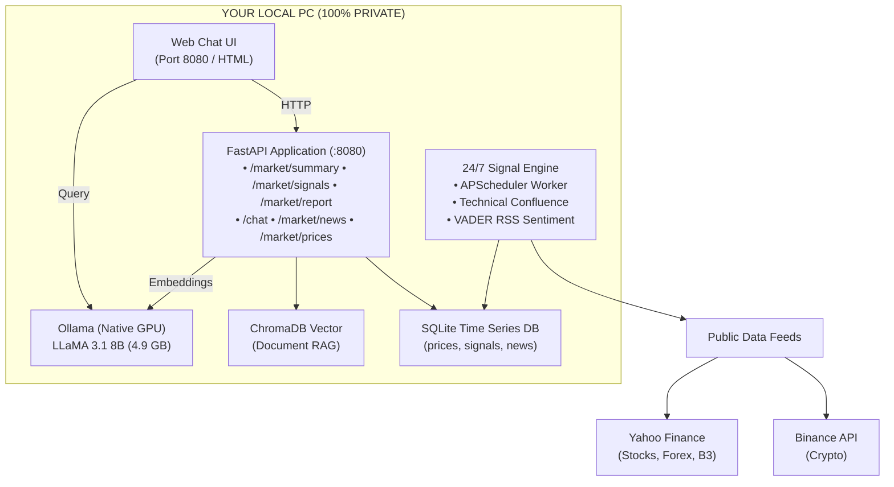
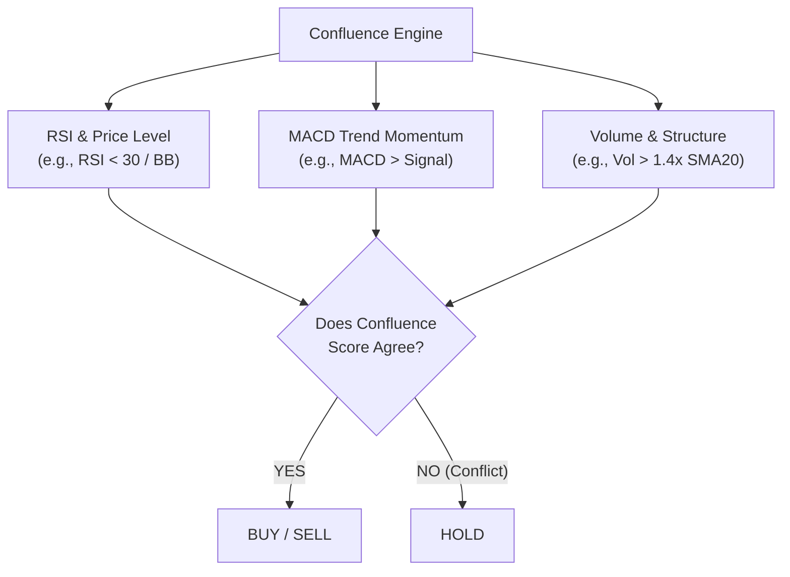

# Finance AI Quantitative Market Signal & Local Advisory System

A **100% self-hosted, offline, and zero-cost financial intelligence suite** combining a **24/7 quantitative indicator scanner** with a **private local LLM financial advisor (LLaMA 3.1 8B)**. 

Runs entirely on consumer hardware (tested on an **AMD Ryzen 7 5700X3D + NVIDIA RTX 4060 8GB**). Zero third-party API costs, zero cloud subscriptions, zero data leaks.

---

## Table of Contents

- [Overview & Philosophy](#-overview--philosophy)
- [System Architecture](#-system-architecture)
- [The Two-Brain Architecture](#-the-two-brain-architecture)
- [Core Features](#-core-features)
- [Quantitative Indicator Methodology](#-quantitative-indicator-methodology)
  - [1. Relative Strength Index (RSI)](#1-relative-strength-index-rsi)
  - [2. Moving Average Convergence Divergence (MACD)](#2-moving-average-convergence-divergence-macd)
  - [3. Bollinger Bands (BB)](#3-bollinger-bands-bb)
  - [4. Trend EMAs & Volume Anomalies](#4-trend-emas--volume-anomalies)
  - [5. Confluence Matrix (Why HOLD on Oversold?)](#5-confluence-matrix-why-hold-on-oversold)
- [NLP News Sentiment Engine](#-nlp-news-sentiment-engine)
- [Measuring Whether It Works](#-measuring-whether-it-works)
- [Running It for Months at Home](#-running-it-for-months-at-home)
- [Tracked Asset Coverage](#-tracked-asset-coverage)
- [Project Directory Structure](#-project-directory-structure)
- [Hardware & Software Prerequisites](#-hardware--software-prerequisites)
- [Quick Start Installation (Windows)](#-quick-start-installation-windows)
- [Interactive Web Dashboard](#-interactive-web-dashboard)
- [REST API Reference](#-rest-api-reference)
- [Alert Setup (Telegram & Email)](#-alert-setup-telegram--email)
- [Customization & Adding Assets](#-customization--adding-assets)
- [Frequently Asked Questions (FAQ)](#-frequently-asked-questions-faq)
- [Disclaimer & License](#-disclaimer--license)

---

## Overview & Philosophy

Most commercial financial AI products charge recurring monthly subscriptions ($20–$100/mo) or per-token API fees while routing your private portfolio data through external corporate servers. Furthermore, pure language models (like raw ChatGPT or Claude) cannot reliably track live numerical prices or perform rapid statistical calculus across thousands of financial candles.

**Finance AI solves both problems by separating math from language:**

1. **The Quantitative Engine:** A lightweight, high-performance background daemon that pulls 5-minute candle data, computes technical indicator calculus via vectorized Pandas/NumPy, and evaluates rule-based confluence voting.
2. **The AI Advisory Engine:** An offline, GPU-accelerated large language model (**LLaMA 3.1 8B** via **Ollama**) that ingests the quantitative engine's findings and synthesizes plain-English market briefs, answers ad-hoc questions, and assesses trade risk.

---

## System Architecture

---

## The Two-Brain Architecture

| Feature | The Quantitative Engine | The AI Advisor (LLaMA 3.1) |
| :--- | :--- | :--- |
| **Role** | Data collection, statistics, indicator calculus | Reasoning, natural language synthesis, strategy |
| **Frequency** | Every 5 minutes (continuous 24/7 background) | On-demand (when you ask or generate a report) |
| **Resource Usage**| ~0.1% CPU, minimal RAM | Active only during inference on NVIDIA GPU |
| **Output** | Numerical metrics, JSON signals, confidence % | Formatted executive briefings, conversational answers |
| **Speed** | Sub-second across 24 assets | ~20 tokens/sec on RTX 4060 |

---

## Core Features

- **Multi-Market Scanning**: Live tracking across US Mega-Cap Tech, S&P 500 / NASDAQ ETFs, Cryptocurrencies, Major Forex pairs, and Brazilian Equities (B3).
- **Rule-Based Confluence Voting**: A strict multi-indicator agreement matrix, now including recent news sentiment as one vote.
- **Completed Candles Only**: Signals are computed on finished candles, and only stored when a new candle exists, so closed markets don't produce a stream of duplicate signals.
- **Honest Walk-Forward Backtester**: Replays the exact live rules over months of history, counts each signal once, subtracts realistic trading costs and compares against simply holding the asset.
- **Live Track Record**: Every BUY/SELL signal is graded 1h, 4h and 24h after it was issued. After a few months this is real, hindsight-free evidence of whether the signals work.
- **ML Research Bench**: A walk-forward machine-learning experiment that tests whether a model beats the rules on your accumulated data.
- **Falling Knife Protection**: Automatically holds back on BUY signals when momentum is still collapsing, even if RSI is deeply oversold.
- **VADER News Sentiment Analysis**: Continuously scans financial RSS feeds (Reuters, Yahoo Finance, CoinDesk, InfoMoney) and calculates real-time market sentiment (-1.0 to +1.0).
- **One-Click AI Executive Briefings**: Instantly prompts local LLaMA 3.1 to synthesize technical data into a strategic market report.
- **Instant Push Alerts**: Sends **Telegram** and **Email (SMTP)** alerts when a new STRONG_BUY / STRONG_SELL appears (once per signal, not every 5 minutes).
- **Zero-Dependency Native Mode**: Runs directly on Windows with Python and SQLite, no WSL or Docker virtualization required.

---

## Quantitative Indicator Methodology

### 1. Relative Strength Index (RSI)
Calculated with Wilder's 14-period exponential smoothing:

```math
\text{RSI} = 100 - \left( \frac{100}{1 + \text{RS}} \right)
```

Where:
```math
\text{RS} = \frac{\text{Average Gain}}{\text{Average Loss}}
```
over the last 14 five-minute candles.
- **RSI < 30:** Asset is **Oversold** (heavy liquidation, potential discount).
- **RSI > 70:** Asset is **Overbought** (speculative euphoria, high risk of reversal).

### 2. Moving Average Convergence Divergence (MACD)
Calculated using standard 12-period fast EMA and 26-period slow EMA:

```math
\text{MACD Line} = \text{EMA}_{12}(\text{Close}) - \text{EMA}_{26}(\text{Close})
```
```math
\text{Signal Line} = \text{EMA}_{9}(\text{MACD Line})
```
```math
\text{Histogram} = \text{MACD Line} - \text{Signal Line}
```

- **MACD > Signal Line & Histogram > 0:** Bullish momentum accelerating.
- **MACD < Signal Line & Histogram < 0:** Bearish momentum accelerating.

### 3. Bollinger Bands (BB)
Measures statistical volatility using a 20-period Simple Moving Average and $\pm 2$ standard deviations ($\sigma$):

```math
\text{Upper Band} = \text{SMA}_{20} + (2 \times \sigma_{20})
```
```math
\text{Lower Band} = \text{SMA}_{20} - (2 \times \sigma_{20})
```

The engine measures position within the bands as a z-score, $z = (\text{Close} - \text{SMA}_{20}) / \sigma_{20}$, and votes when $|z| \ge 2$. A z-score means the same thing for a calm FX pair and a volatile altcoin (a fixed "within 1% of the band" rule fires almost constantly on low-volatility assets).

### 4. Trend EMAs & Volume Anomalies
- **EMA Alignment:** Evaluates short-term momentum by comparing $\text{EMA}_9$ against $\text{EMA}_{21}$, and long-term trend against $\text{EMA}_{50}$ / $\text{EMA}_{200}$.
- **Volume Ratio:** Flags volume surges where $\text{Volume} \ge 1.4 \times \text{SMA}_{20}(\text{Volume})$, confirming that institutional volume supports the price action.

### 5. Confluence Matrix (Why HOLD on Oversold?)
The engine requires **multi-factor confirmation** before issuing actionable trade signals:



* **Example:** If Bitcoin's RSI hits **21.7** (heavily oversold), but the MACD histogram is negative and dropping, the system refuses to buy. It issues a **`HOLD`** to prevent entering a cascading drop. It upgrades to **`BUY`** only once momentum flattens or curls upward.
* **News vote:** when at least 2 headlines tagged with the asset appeared in the last 6 hours and their average sentiment is beyond ±0.25, sentiment adds one bullish or bearish point (tunable in `.env`, `SENTIMENT_WEIGHT=0` disables it).
* **Rule score ≠ probability:** the score shown next to each signal (formerly "confidence") only ranks how many factors agree. How often a signal type is actually right is the **hit rate**, which is measured, not assumed. When there are fewer than 20 historical cases, the dashboard says "unproven" instead of showing a number.

---

## NLP News Sentiment Engine

Every 15 minutes, the sentiment engine parses global financial news feeds:
- **Global / US:** Yahoo Finance RSS, Investing.com
- **Crypto:** CoinDesk, Cointelegraph
- **Brazil (B3):** InfoMoney, Folha Mercado

Headlines are processed through the **VADER (Valence Aware Dictionary and sEntiment Reasoner)** NLP pipeline to generate a normalized compound polarity score:
- **Compound Score > +0.05:** Categorized as **Bullish**
- **Compound Score < -0.05:** Categorized as **Bearish**
- **-0.05 to +0.05:** Categorized as **Neutral**

Headlines are tagged to assets with whole-word keyword matching (short tickers like `ETH` or `ADA` are case-sensitive, so "method" or "Canada" don't get tagged).

> **Limitation:** VADER is an English-language model. Portuguese headlines (InfoMoney, Folha) mostly score near zero, so news currently has little influence on B3 signals.

---

## Measuring Whether It Works

Indicators that look convincing on a chart often don't make money after costs. The system now measures this three ways.

### 1. Backfill history
```bash
python -m signal_engine.backfill            # ~90 days for crypto, ~60 days for stocks/forex (Yahoo's limit)
```

### 2. Walk-forward backtest
```bash
python -m signal_engine.backtester                  # all assets, 1-hour holding period
python -m signal_engine.backtester --horizon 48     # 4-hour holding period
python -m signal_engine.backtester --symbols BTCUSDT ETHUSDT
```
It replays the exact live rules candle by candle (no look-ahead), counts each signal only when it first appears, subtracts round-trip costs (crypto 0.20%, US stocks 0.05%, B3 0.10%, forex 0.03%, editable in `.env`) and reports per signal type:

| Column | Meaning |
| :--- | :--- |
| `entries` | independent signals (5-minute repeats of the same signal are not counted) |
| `hit%` | share that made money after costs |
| `avg net%` | average return per signal after costs |
| `edge vs long%` | return compared with simply holding the asset over the same period, **the number that matters** |
| `t` | t-statistic of that edge; above ~2 suggests it isn't luck |

It also simulates following the signals long-only versus buy & hold. The engine re-runs this every 6 hours, and the dashboard's **Track Record → Backtest** tab shows the pooled result.

### 3. Live track record (the real test)
Every BUY/SELL signal is graded automatically 1h, 4h and 24h after it was issued. Unlike a backtest, these signals were produced before the outcome existed, so they can't be flattered by hindsight. See **Track Record → Live** in the dashboard or `GET /market/performance`.

How to judge it after a few months:
* Look at the **pooled** rows and at **edge vs long**, not hit rate alone (in a rising market even random BUYs "win" often).
* With 24 assets × 4 signal types, a few cells will look great by pure chance. Trust results that hold across horizons, markets and time.
* Rows with fewer than 20 signals are dimmed: too few to conclude anything.

### 4. ML experiment (optional)
```bash
pip install -r requirements_research.txt
python -m research.ml_experiment --market crypto --horizon 12
```
Trains gradient boosting and logistic regression on indicator, return, time-of-day and news-sentiment features with purged walk-forward validation, and compares trading on its predictions against always-long and the rule-based BUYs. It is validated to find nothing in pure noise and to find a planted pattern, so a positive result on your data is worth a closer look; a result of AUC ≈ 0.50 means no predictive signal.

---

## Running It for Months at Home

* **Raspberry Pi / always-on machine:** copy `finance-ai.service` to `/etc/systemd/system/`, then `sudo systemctl enable --now finance-ai`. It restarts automatically on crashes and reboots.
* **Access from other devices:** by default the dashboard only listens on this computer (`HOST=127.0.0.1`). To open it from your phone, set `HOST=0.0.0.0` **and** `API_KEY=<some long random string>` in `.env`; the dashboard asks for the key once.
* **Health check:** the header shows *Engine live* or *Engine stalled*; `GET /health` reports minutes since the last cycle.
* **Logs:** `data/logs/finance-ai.log` (rotated at 10 MB, 10 files kept).
* **Backups:** a snapshot of the database is written daily to `data/backups/` (newest 7 kept). Copy one off the machine now and then.
* **Disk use:** at most about 3 MB per day with the default 24 assets (~1 GB per year), so an SD card or small disk is fine.
* **Data sources:** Yahoo Finance data via `yfinance` is fine for personal research but isn't licensed for commercial use. A product built on this would need a licensed data provider.

---

## Tracked Asset Coverage

The default seed watchlist monitors **24 assets** across four major market classes:

| Category | Assets Monitored | Data Source |
| :--- | :--- | :--- |
| **US Equities & ETFs** | `AAPL`, `MSFT`, `NVDA`, `TSLA`, `AMZN`, `GOOGL`, `META`, `SPY`, `QQQ` | Yahoo Finance |
| **Cryptocurrencies** | `BTCUSDT`, `ETHUSDT`, `SOLUSDT`, `BNBUSDT`, `XRPUSDT`, `ADAUSDT`, `DOGEUSDT` | Binance Public API |
| **Forex Pairs** | `EURUSD=X`, `GBPUSD=X`, `USDJPY=X` | Yahoo Finance |
| **Brazilian Stocks (B3)** | `PETR4.SA`, `VALE3.SA`, `ITUB4.SA`, `BBDC4.SA`, `ABEV3.SA` | Yahoo Finance |

---

## Project Directory Structure

```text
finance-ai/
├── alerts/
│   ├── __init__.py
│   ├── email_alerts.py          # SMTP HTML trade alert dispatcher
│   └── telegram_bot.py          # Telegram Bot API alert dispatcher
├── api/
│   ├── __init__.py
│   ├── finance_tools.py         # Transaction categorization & budgeting
│   ├── main.py                  # FastAPI server & route handlers
│   └── models.py                # Pydantic data validation schemas
├── data/
│   ├── finance.db               # SQLite database (auto-created on first run)
│   ├── uploads/                 # Storage for user financial documents
│   └── vectordb/                # ChromaDB vector embedding storage
├── frontend/
│   └── index.html               # Responsive single-page dashboard & chat UI
├── prompts/
│   └── system_prompt.md         # System instructions for LLaMA 3.1 advisor
├── rag/
│   ├── __init__.py
│   ├── embeddings.py            # Ollama nomic-embed-text wrapper
│   ├── ingest.py                # Document chunking & vectorization
│   └── retriever.py             # Vector similarity search
├── signal_engine/
│   ├── __init__.py
│   ├── backfill.py              # Download months of history for backtests
│   ├── backtester.py            # Walk-forward backtest with costs & baselines
│   ├── config.py                # Costs, horizons, sentiment settings (env-overridable)
│   ├── database.py              # SQLite storage (UTC timestamps, backups, tracking tables)
│   ├── data_fetcher.py          # Multi-market price data fetcher
│   ├── main.py                  # Standalone worker daemon entrypoint
│   ├── models.py                # Shared dataclasses & enums
│   ├── scheduler.py             # APScheduler background task manager
│   ├── sentiment.py             # VADER news sentiment analyzer
│   ├── technical_analysis.py    # Vectorized indicator math (pure Pandas/NumPy)
│   └── tracker.py               # Live forward tracking of every signal
├── research/
│   └── ml_experiment.py         # Walk-forward ML experiment (optional, scikit-learn)
├── tests/                       # Unit tests (python -m unittest discover tests)
├── .env.example                 # Configuration template
├── Dockerfile.api               # Optional Docker container for API
├── Dockerfile.signal            # Optional Docker container for worker
├── docker-compose.yml           # Optional Docker deployment
├── requirements.txt             # Python package dependencies
├── run_local.py                 # Primary Windows Python runner
├── run.bat                      # One-click Windows batch launcher
└── README.md                    # System documentation
```
---

## Hardware & Software Prerequisites

- **Operating System:** Windows 10/11, macOS, or Linux
- **Python:** Version 3.10 to 3.14
- **Ollama:** Installed from [ollama.com](https://ollama.com) (runs in background tray)
- **Recommended GPU:** NVIDIA GPU with 8GB+ VRAM (e.g. RTX 3060/4060/4070 or better) for rapid inference (~20 tokens/sec). CPU inference is supported automatically as fallback.

---

## Quick Start Installation (Windows)

### 1. Clone the Repository
```bash
git clone https://github.com/your-username/finance-ai.git
cd finance-ai
```

### 2. Install Python Dependencies
```bash
py -m pip install -r requirements.txt
```

### 3. Pull the Local AI Model
Ensure Ollama is running, then pull the model:
```bash
ollama pull llama3.1:8b
```

### 4. Launch the System
Double-click **`run.bat`** or run:
```cmd
.\run.bat
```
*(Or via PowerShell: `py run_local.py`)*

The system will:
1. Initialize the SQLite database and seed the default watchlist.
2. Spin up the background 24/7 market & sentiment scanner thread.
3. Start the FastAPI server on `http://localhost:8080`.
4. Automatically open your browser to the Web Dashboard!

---

## Interactive Web Dashboard

Access the dashboard at **`http://localhost:8080`**:

- **Real-Time Summary Bar:** Shows total assets tracked, current count of active BUY/SELL signals, and market-wide news sentiment score.
- **Confluence Table:** Displays each asset with its live price, actionable signal pill (`STRONG BUY`, `BUY`, `HOLD`, `SELL`), color-coded RSI badge, confidence meter, and individual indicator rationale tags.
- **Market Filters:** One-click filtering between `All`, `Crypto`, `US Tech`, `B3 Brazil`, and `Forex`.
- **Built-in Signal Guide:** Click **"Signal Guide"** in the top navigation bar to open a collapsible tutorial on RSI, MACD, and confluence mechanics.
- **AI Executive Brief:** Click **"AI Market Brief"** to have LLaMA 3.1 synthesize all current signals into a structured market analysis.
- **GPU Advisor Chat:** Chat directly with your local LLM about any stock, indicator reading, or macroeconomic event.

---

## REST API Reference

The interactive Swagger documentation is available at **`http://localhost:8080/docs`**.

### Key Endpoints

| Method | Endpoint | Description |
| :--- | :--- | :--- |
| `GET` | `/market/summary` | Aggregated counts of BUY/SELL/HOLD signals & news sentiment |
| `GET` | `/market/signals` | List deduplicated live signals (`latest_only=true`) or historical signals |
| `GET` | `/market/news` | Recent financial headlines tagged with VADER sentiment |
| `GET` | `/market/watchlist` | View all active assets being monitored |
| `POST`| `/market/watchlist` | Add a new ticker to the continuous 24/7 scanning cycle |
| `DELETE`| `/market/watchlist/{symbol}`| Remove an asset from the scanning cycle |
| `GET` | `/market/prices/{symbol}` | Fetch raw OHLCV price history for charting |
| `POST`| `/market/report` | Trigger local LLM to generate an executive market report |
| `POST`| `/chat` | Conversational endpoint connecting user queries with market data & LLaMA |
| `GET` | `/market/performance` | Live track record per horizon and signal type (`?days=30` to limit the window) |
| `GET` | `/market/backtest` | Latest walk-forward backtest results per asset and signal type |
| `GET` | `/health` | Engine heartbeat (minutes since last cycle) and Ollama status |

When `API_KEY` is set, every endpoint except `/` and `/health` requires the header `X-API-Key: <key>`.

---

## Alert Setup (Telegram & Email)

Copy `.env.example` to `.env`:
```powershell
Copy-Item .env.example .env
```

### 1. Telegram Push Notifications
1. Message **@BotFather** on Telegram and send `/newbot` to create your alert bot.
2. Copy the bot token into your `.env`:
   ```env
   TELEGRAM_BOT_TOKEN=123456789:ABCdefGHIjklMNOpqrSTUvwxYZ
   ```
3. Send any message to your new bot, then visit:
   `https://api.telegram.org/bot<YOUR_TOKEN>/getUpdates`
4. Copy the `"id"` value from the `"chat"` object and add it to `.env`:
   ```env
   TELEGRAM_CHAT_ID=987654321
   ```

### 2. Gmail SMTP Alerts
1. In your Google Account, enable **2-Factor Authentication**.
2. Navigate to **Security -> App Passwords** and generate a password for "Mail".
3. Update `.env`:
   ```env
   ALERT_EMAIL_TO=your-email@gmail.com
   SMTP_HOST=smtp.gmail.com
   SMTP_PORT=587
   SMTP_USER=your-email@gmail.com
   SMTP_PASSWORD=your-16-char-app-password
   ```

---

## Customization & Adding Assets

### Add a Ticker via the API
You can add any stock, crypto, or currency pair dynamically:

```bash
curl -X POST http://localhost:8080/market/watchlist   -H "Content-Type: application/json"   -d '{
    "symbol": "AMD",
    "market": "us_stocks",
    "display_name": "Advanced Micro Devices"
  }'
```

- For **US Stocks & ETFs**: Use standard ticker symbols (e.g. `AMD`, `COIN`, `VOO`).
- For **Crypto**: Use Binance USDT pairs (e.g. `AVAXUSDT`, `LINKUSDT`).
- For **Forex**: Use Yahoo currency format (e.g. `AUDUSD=X`).
- For **Brazilian Stocks**: Append `.SA` (e.g. `WEGE3.SA`, `MGLU3.SA`).

---

## Frequently Asked Questions (FAQ)

#### Q: Will running this system slow down my PC while gaming or working?
**A:** No. The quantitative engine runs lightweight math every 5 minutes using negligible CPU (~0.1%). The LLaMA 3.1 model only loads into GPU VRAM when you actively submit a chat question or click "AI Market Brief", leaving your GPU completely free the rest of the time.

#### Q: Can I run this without an NVIDIA GPU?
**A:** Yes. Ollama automatically falls back to CPU mode if no compatible NVIDIA CUDA GPU is detected. It will run slightly slower, but is fully functional.

#### Q: Are any external API keys required to start?
**A:** No. Out of the box, data is pulled using free public endpoints from Yahoo Finance and Binance. Telegram, Email, and Alpha Vantage keys are strictly optional.

---

## Running the Tests

```bash
python -m unittest discover tests
```
The suite checks indicator math, that backtests have no look-ahead and match live signals, that random data shows no edge, database migrations, live outcome grading, news tagging, and (if scikit-learn is installed) the ML pipeline.

---

## Disclaimer

### Disclaimer
> **IMPORTANT:** This software is an experimental quantitative analytics platform designed for educational, research, and informational purposes only. It **does not constitute financial, investment, legal, or tax advice**. Technical indicators and past performance are no guarantee of future market returns. Always conduct your own independent research and consult a licensed financial advisor before making investment decisions.


